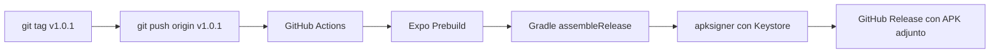

# 🥗 Diario Nutricional — App Móvil (Android)

<p align="center">
  
</p>

<p align="center">
  <b>Aplicación móvil nativa para Android construida con React Native (Expo) y TypeScript.</b><br />
  Sincronización en tiempo real con Firebase Firestore, reconocimiento de platos mediante visión por IA y sistema de auto-actualización continuo desde GitHub Releases.
</p>

<p align="center">
  
  
  
  
  
  
</p>

---

## 📋 Tabla de Contenidos

1. [Características Principales](#-características-principales)
2. [Arquitectura y Buenas Prácticas](#-arquitectura-y-buenas-prácticas)
3. [Puesta en Marcha (Desarrollo)](#-puesta-en-marcha-desarrollo)
4. [Estructura del Proyecto](#-estructura-del-proyecto)
5. [Compilación y Releases con GitHub Actions](#-compilación-y-releases-con-github-actions)
6. [Sistema de Auto-Actualización In-App](#-sistema-de-auto-actualización-in-app)
7. [Configuración y Seguridad](#-configuración-y-seguridad)

---

## ✨ Características Principales

- 📱 **Diseño Nativo con Pestañas Inferiores:** Arquitectura desacoplada en 3 pestañas principales (*🥗 Diario, 📋 Histórico, 📈 Peso*) con safe-area insets y cero saturación visual.
- ⤓ **Copiar Comida de Ayer:** Botón contextual en cada comida que detecta si el día previo tenía registro para duplicarlo con un solo toque.
- 📸 **Subida Múltiple con IA (Lotes):** Selección múltiple de fotos de la galería con procesamiento concurrente en cola con visión por IA y guardado en bloque.
- 📈 **Gráfica Nativa de Evolución de Peso:** Seguimiento visual en SVG nativo (`react-native-svg`), métricas de progreso (variación, mín, máx) e historial editable.
- 📋 **Histórico y Resumen por Rango:** Consulta de periodos (7, 14, 30 días), métricas agregadas de hidratación y comidas fuera, y navegación cruzada para editar cualquier día.
- 📄 **Exportación a PDF por Rango de Fechas:** Generación de informes nutricionales elegantes y detallados con cálculo de medias de agua y comidas, listos para compartir o imprimir.
- ✨ **Animaciones y UX Cuidada:** Transiciones elegantes de cambio de día a 60 FPS, scroll pulido con auto-ocultación de teclado y feedback visual de foco activo en cada campo de comida y peso.
- 🥗 **Registro Completo de Comidas:** 5 comidas diarias (*Desayuno, Media mañana, Comida, Merienda y Cena*) con selector rápido de *"Comida fuera de casa"*.
- 💧 **Contador de Agua:** Stepper intuitivo para sumar o restar consumo (`+0.25L`, `+0.5L`, `-0.25L`, `-0.5L`).
- 🎨 **Icono Oficial Instalable:** Icono adaptativo para Android con paleta de marca `#7A9E7E` y compatibilidad con launcher circular, squircle y Material You mono.
- 🔐 **Persistencia de Sesión Segura:** Conexión con Firebase Auth almacenada nativamente en `@react-native-async-storage/async-storage` (solo inicias sesión una vez).
- 🔄 **Auto-actualizaciones In-App:** La aplicación comprueba automáticamente si hay una nueva versión publicada en GitHub Releases y ofrece descargar e instalar el `.apk` con un toque.

---

## 🏛 Arquitectura y Buenas Prácticas

El proyecto sigue una arquitectura modular y desacoplada, priorizando:
- **Archivos pequeños y con responsabilidad única:** Los componentes de UI están aislados de la lógica de negocio; no hay componentes gigantes.
- **Capa de Servicios (`services/`):** Aísla Firebase Auth, Firestore y llamadas HTTP a la API de IA.
- **Custom Hooks (`hooks/`):** Encapsulan el ciclo de vida del estado (`useAuth`, `useDiario`, `useFotoPlato`, `useActualizador`).
- **Seguridad primero:** Ninguna clave privada o keystore se almacena en el control de versiones.

---

## 🚀 Puesta en Marcha (Desarrollo)

### Requisitos previos
- [Node.js](https://nodejs.org/) v20 o superior.
- [pnpm](https://pnpm.io/) (`corepack enable && corepack prepare pnpm@latest --activate`).
- Teléfono Android con la app gratuita **Expo Go** instalada desde Google Play.

### 1. Clonar e instalar dependencias
```bash
git clone git@github.com:suarezoscar/diario-nutricional-app.git
cd diario-nutricional-app
pnpm install
```

### 2. Iniciar el entorno local
```bash
pnpm start
```

### 3. Ejecutar en tu teléfono
- Escanea con la cámara de tu móvil o desde la aplicación **Expo Go** el código QR que se mostrará en tu terminal.
- La aplicación se cargará de inmediato en tu dispositivo con *Fast Refresh* activado.

### 4. Verificación de TypeScript
```bash
pnpm run typecheck
```

---

## 📁 Estructura del Proyecto

```
diario-nutricional-app/
├── .github/workflows/
│   └── build-apk.yml           # Flujo de CI/CD para compilar y firmar el APK en GitHub Actions
├── assets/                     # Iconos y splash screens nativos
├── src/
│   ├── types/
│   │   └── index.ts            # Definiciones de TypeScript (Registro, ClaveComida, Usuario)
│   ├── config/
│   │   ├── constants.ts        # Constantes de versión, endpoints y repositorios
│   │   ├── comidas.ts          # Configuración de las 5 comidas con sus iconos
│   │   └── firebase.ts         # Inicialización de Firebase con persistencia AsyncStorage
│   ├── services/
│   │   ├── authService.ts      # Métodos de autenticación y sesión
│   │   ├── registroService.ts  # Operaciones de lectura y escritura en Firestore
│   │   ├── iaService.ts        # Llamadas al endpoint de visión por IA
│   │   └── updateService.ts    # Consulta de GitHub Releases y descarga de APKs
│   ├── hooks/
│   │   ├── useAuth.ts          # Estado global de usuario y login
│   │   ├── useDiario.ts        # Estado del día activo y guardado de datos
│   │   ├── useFotoPlato.ts     # Captura de cámara/galería y análisis IA
│   │   └── useActualizador.ts  # Comprobación automática y manual de nuevas versiones
│   ├── utils/
│   │   ├── theme.ts            # Sistema de diseño (paleta verde, espacios, radios)
│   │   └── fechas.ts           # Utilidades de fechas en español (hoy, formatear, sumar días)
│   └── components/
│       ├── auth/
│       │   └── LoginView.tsx   # Pantalla de inicio de sesión
│       ├── common/
│       │   ├── Header.tsx      # Barra superior con logo, versión y cerrar sesión
│       │   ├── DateBar.tsx     # Selector de fechas (< Fecha > y botón Hoy)
│       │   └── Card.tsx        # Contenedor de tarjeta estilizada
│       └── diario/
│           ├── ComidaCard.tsx  # Tarjeta de comida con multilínea, contador y botón IA
│           ├── AguaCard.tsx    # Tarjeta de agua con botones de incremento
│           ├── PesoCard.tsx    # Tarjeta de peso corporal y ejercicio
│           └── DiarioView.tsx  # Composición de la pantalla principal
├── app.json                    # Manifiesto de Expo y configuración de Android
├── App.tsx                     # Orquestador raíz de la aplicación
└── package.json
```

---

## 📦 Compilación y Releases con GitHub Actions

El repositorio incluye un flujo de trabajo automatizado en [`.github/workflows/build-apk.yml`](.github/workflows/build-apk.yml) que genera el APK de producción listo para instalar:



### Cómo publicar una nueva versión:
1. Actualiza la versión en `app.json` y `src/config/constants.ts`:
   ```json
   "version": "1.0.1",
   "android": {
     "versionCode": 2
   }
   ```
2. Crea y sube el tag:
   ```bash
   git tag v1.0.1
   git push origin v1.0.1
   ```
3. GitHub Actions compilará automáticamente el archivo `DiarioNutricional-v1.0.1.apk` y lo publicará en la pestaña **Releases**.

---

## 🔄 Sistema de Auto-Actualización In-App

No necesitas subir la app a Google Play para mantener a los usuarios actualizados:
1. Al abrir la app, [`useActualizador.ts`](src/hooks/useActualizador.ts) consulta la API de GitHub:
   `https://api.github.com/repos/suarezoscar/diario-nutricional-app/releases/latest`
2. Compara semánticamente la versión remota con la local.
3. Si detecta una versión superior, muestra una alerta nativa:
   > *"Existe una nueva versión (v1.0.1). ¿Deseas descargarla e instalarla ahora?"*
4. Al pulsar **Descargar e Instalar**, el navegador abre el enlace directo del APK y Android inicia el instalador del sistema.
5. También puedes pulsar el botón de nube ☁️ en la cabecera para forzar una comprobación manual.

---

## 🔒 Configuración y Seguridad

- **Keystore de Firma:** Las variables de firma se inyectan a través de **GitHub Repository Secrets** (`ANDROID_KEYSTORE_BASE64`, `KEYSTORE_PASSWORD`, `KEY_ALIAS`, `KEY_PASSWORD`) para que la firma sea idéntica en cada compilación sin exponer archivos en el repositorio.
- **Variables de Entorno:** Copia `.env.example` a `.env` si deseas sobrescribir las claves de Firebase de forma local.

---

## 📄 Licencia

Este proyecto está bajo la Licencia MIT.
